  

  <a href="https://git.io/typing-svg">
    <picture>
      <source media="(prefers-color-scheme: dark)" srcset="https://readme-typing-svg.demolab.com?font=Fira+Code&weight=600&size=26&pause=1000&color=1AF7C5&center=true&vCenter=true&width=500&lines=Hey+!+%F0%9F%91%8B+I'm+Sayt0+!" />
      <source media="(prefers-color-scheme: light)" srcset="https://readme-typing-svg.demolab.com?font=Fira+Code&weight=600&size=26&pause=1000&color=058568&center=true&vCenter=true&width=500&lines=Hey+!+%F0%9F%91%8B+I'm+Sayt0+!" />
      
    </picture>
  </a>

 

## 👋 About me

- 🎓 Student at EPITA, Paris
- 🐳 Former intern at Docker (3 months), mainly on [docker-agent](https://github.com/docker/docker-agent), where I still contribute: [150+ merged PRs](https://github.com/docker/docker-agent/pulls?q=is%3Apr+author%3ASayt-0+is%3Amerged) (runtime, TUI, MCP, Claude Code harness)
- 🤖 I build tools to run and steer coding agents, and the agents themselves

 

## 🌍 Languages

  <picture>
    <source media="(prefers-color-scheme: dark)" srcset="https://skillicons.dev/icons?i=c%2Ccpp%2Cgo%2Cts%2Cjs%2Cpython%2Cocaml%2Cbash%2Chtml%2Ccss%2Cmysql&theme=dark" />
    <source media="(prefers-color-scheme: light)" srcset="https://skillicons.dev/icons?i=c%2Ccpp%2Cgo%2Cts%2Cjs%2Cpython%2Cocaml%2Cbash%2Chtml%2Ccss%2Cmysql&theme=light" />
    
  </picture>

 

## ⚙️ Tools & Environments

  <picture>
    <source media="(prefers-color-scheme: dark)" srcset="https://skillicons.dev/icons?i=git%2Cgithub%2Cdocker%2Clinux%2Cnodejs%2Cgithubactions%2Csqlite%2Cpostgres%2Clatex%2Cvisualstudio%2Cvscode%2Cvim&theme=dark" />
    <source media="(prefers-color-scheme: light)" srcset="https://skillicons.dev/icons?i=git%2Cgithub%2Cdocker%2Clinux%2Cnodejs%2Cgithubactions%2Csqlite%2Cpostgres%2Clatex%2Cvisualstudio%2Cvscode%2Cvim&theme=light" />
    
  </picture>

 

## 🖥️ Operating Systems

  <picture>
    <source media="(prefers-color-scheme: dark)" srcset="https://skillicons.dev/icons?i=ubuntu%2Carch%2Cnix%2Capple%2Cwindows&theme=dark" />
    <source media="(prefers-color-scheme: light)" srcset="https://skillicons.dev/icons?i=ubuntu%2Carch%2Cnix%2Capple%2Cwindows&theme=light" />
    
  </picture>

 

## ⚡ GitHub Stats

  <picture>
    <source media="(prefers-color-scheme: dark)" srcset="https://raw.githubusercontent.com/Sayt-0/Sayt-0/main/cards/top-langs-dark.svg" />
    <source media="(prefers-color-scheme: light)" srcset="https://raw.githubusercontent.com/Sayt-0/Sayt-0/main/cards/top-langs-light.svg" />
    
  </picture>
  <picture>
    <source media="(prefers-color-scheme: dark)" srcset="https://raw.githubusercontent.com/Sayt-0/Sayt-0/main/cards/stats-dark.svg" />
    <source media="(prefers-color-scheme: light)" srcset="https://raw.githubusercontent.com/Sayt-0/Sayt-0/main/cards/stats-light.svg" />
    
  </picture>

 

  

